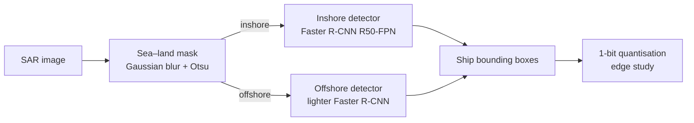

# 🚢 Small Vessel Detection in SAR Imagery

**Scene-aware ship detection in Synthetic Aperture Radar images: separate Faster R-CNN detectors for inshore and offshore scenes, a sea–land mask, and an edge-deployment study of 1-bit quantisation.**

---

## 📌 Problem

Small vessels are hard to detect in SAR imagery. They cover only a few pixels, and near the coast they blend into strong land clutter (ports, buildings, breakwaters). One detector for every scene tends to under-perform on both.

## 💡 Approach

1. **Data**: Kaggle SAR ship dataset (downloaded with `kagglehub`), converted from **Pascal VOC XML to COCO JSON** and registered with Detectron2.
2. **Sea–land masking**: Gaussian blur and Otsu thresholding produce a binary land/sea mask that splits the test set into **inshore** and **offshore** scenes.
3. **Scene-specific models**
   - *Inshore*: Faster R-CNN with a **ResNet-50-FPN** backbone (COCO-pretrained) for cluttered coastal scenes
   - *Offshore*: a smaller, lower-parameter Faster R-CNN, since open-sea scenes are simpler
4. **Evaluation**: COCO metrics (AP, AP-small) with `COCOEvaluator`, plus visualisations of high-confidence detections.
5. **Edge deployment analysis**: estimates the FP32 → **1-bit** model-size reduction (32× smaller) and simulates the accuracy cost by keeping only the strongest detections.

## 🛠️ Tech Stack

Detectron2 · PyTorch · OpenCV · pycocotools · scikit-image · NumPy · pandas · Matplotlib · kagglehub

## 🚀 Run

The full pipeline is one notebook, [`SAR_ship_detection.ipynb`](SAR_ship_detection.ipynb), organised into 11 blocks (install → data → masking → model config → training → evaluation → visualisation → quantisation study).

1. Open it in **Google Colab** with a GPU runtime
2. Run the blocks in order. Block 1 installs Detectron2 and downloads the dataset

## 👩‍💻 Author

**Ghanasree S**: [GitHub](https://github.com/Ghanasree-S) · [LinkedIn](https://www.linkedin.com/in/ghanasree-s-88976b2b0)
